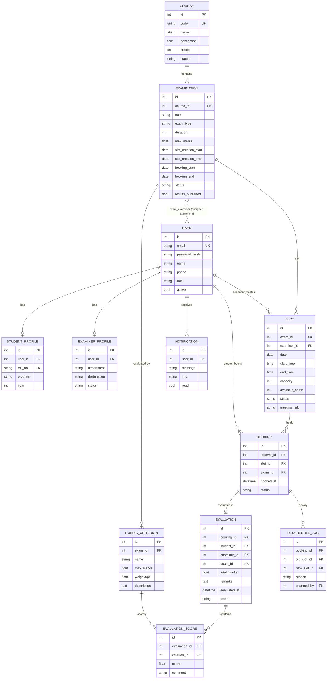

# Examination Management Portal (EMP) – MAD-II

A role-based web app where **Admin**, **Examiners** and **Students** manage the full examination lifecycle:
courses → examinations & rubrics → examiner slots → student bookings → rubric-based evaluation → result publication.

| Layer | Technology |
|---|---|
| API | Flask, Flask-SQLAlchemy, Flask-JWT-Extended (JWT token auth) |
| UI | Vue 3 + Vue Router (CDN), Bootstrap 5 (+ Bootstrap Icons), Chart.js |
| Entry point | One Jinja2 template (`frontend/index.html`) – used only to serve the Vue app |
| Database | SQLite (created programmatically via `db.create_all()`) |
| Caching | Redis via Flask-Caching (falls back to in-memory cache if Redis is not running) |
| Batch jobs | Celery + Redis (worker + beat) |

## Folder structure

```
MAD-II/
├── backend/
│   ├── app.py              # app factory, blueprints, DB + admin creation, serves Vue entry point
│   ├── config.py           # all settings (DB, Redis, SMTP, webhook, schedule)
│   ├── extensions.py       # db, jwt, cache instances
│   ├── models.py           # SQLAlchemy models (unified User model with role)
│   ├── utils.py            # role_required decorator, validation, Redis cache helpers, marks formula
│   ├── routes/             # auth.py, common.py, admin.py, examiner.py, student.py
│   ├── celery_app.py       # Celery instance + beat schedule
│   ├── tasks.py            # daily reminders, monthly report, CSV export, result emails
│   ├── mailer.py           # SMTP email + Google Chat webhook
│   ├── mail_templates/     # HTML email / report templates
│   ├── seed.py             # optional demo data
│   └── requirements.txt
└── frontend/
    ├── index.html          # Jinja2 entry point (CDN scripts)
    ├── manifest.json, sw.js# PWA – "Install app" / add to desktop
    └── static/
        ├── css/style.css
        └── js/
            ├── api.js      # fetch wrapper, session store, toasts, formatters
            ├── app.js      # router + role guards
            └── components/ # common, auth, admin, examiner, student
```

## Running locally (Windows)

```bash
cd MAD-II
python -m venv .venv
.venv\Scripts\activate
pip install -r backend/requirements.txt
```

**1. Redis** – needed for caching and Celery. On Windows use [Memurai](https://www.memurai.com/) or WSL (`sudo apt install redis-server && redis-server`), or Docker: `docker run -p 6379:6379 redis`.

**2. MailHog** (optional, to see emails) – run `MailHog.exe`, then open http://localhost:8025. SMTP defaults to `localhost:1025`.

**3. Start the app** (each in its own terminal, from `backend/`):

```bash
python app.py                                         # Flask on http://localhost:5000
celery -A celery_app.celery worker -l info --pool=solo  # --pool=solo is required on Windows
celery -A celery_app.celery beat -l info              # scheduled jobs
```

**4. Demo data** (optional, run once): `python seed.py`

| Role | Login | Password |
|---|---|---|
| Admin (created automatically) | admin@emp.com | admin123 |
| Examiners (seed) | anita@emp.com, vikram@emp.com, meera@emp.com | examiner123 |
| Students (seed) | student1@emp.com … student6@emp.com | student123 |

To reset everything, delete `backend/instance/emp.sqlite3` and restart; the tables and admin are recreated by code.

Optional environment variables: `GCHAT_WEBHOOK_URL` (Google Chat space webhook for reminders), `SMTP_HOST/PORT/USER/PASSWORD`,
`REMINDER_HOUR/REMINDER_MINUTE`, `ADMIN_EMAIL/ADMIN_PASSWORD`, `REDIS_URL`, `CELERY_TIMEZONE` (default Asia/Kolkata).

## Examination workflow

```
Draft ──open slot creation──▶ Slot Creation ──open booking──▶ Booking Open ──close booking──▶ Closed ──▶ Completed
```

* Examiners can create slots only when the status is **Slot Creation** and today is inside the slot-creation window.
* Examiners can edit/delete a slot only before booking begins and only if it has no bookings.
* Students can book only when the status is **Booking Open** and today is inside the booking window.
* One active booking per student per exam. This is checked in code and also enforced by a partial unique index.
* Overbooking is prevented by an atomic `UPDATE slot SET available_seats = available_seats - 1 WHERE available_seats > 0`. A slot becomes **Full** automatically when no seats are left.
* Students can cancel only while booking is open and on or before the booking deadline.
* Examiners can evaluate only students in their own slots, and only on or after the exam date.
* Admin can reschedule a whole slot (date/time/examiner) or move a single booking to another slot. Picking another examiner's slot reassigns the student. Each change is stored in `RescheduleLog` and the student is notified.
* Marks are shown to students only after the Admin publishes results. Publishing also sends email and in-app notifications.

**Weighted total** = Σ (marks ÷ criterion max × weightage) ÷ Σ weightage × exam max marks. If no weightage is set, it is a plain sum.

## Background jobs (Celery)

| Job | Trigger | What it does |
|---|---|---|
| `tasks.daily_reminders` | Beat, daily at `REMINDER_HOUR:REMINDER_MINUTE` (default 08:00) | Sends every student with a booking today/tomorrow an email (exam name, date & time, examiner, instructions), creates an in-app notification and posts a summary to Google Chat |
| `tasks.monthly_report` | Beat, 1st of every month at 07:00 | Builds an HTML report for the previous month (exams conducted, students evaluated, completed bookings, pending evaluations, most active examiners, per-exam breakdown), emails it to the admin and saves it to `backend/exports/` |
| `tasks.export_history_csv` | Student clicks **Export history (CSV)** | Writes the CSV, then sends an in-app notification and an email. The UI polls the task state and downloads the file |
| `tasks.send_result_emails` | Admin publishes results | Emails each student their marks breakdown |

Admins can also start reminders and the monthly report from **Reports → Send reminders now / Email monthly report now**.

## Caching (Redis)

| Key | Content | Expiry | Invalidated when |
|---|---|---|---|
| `exams:all` | examination list (search/filter runs on this) | 5 min | any exam / course / examiner change |
| `exam:<id>` | exam detail + rubric | 5 min | exam, status, rubric, publish change |
| `exam:<id>:slots` | examination schedule | 60 s | slot create/edit/delete, booking, cancel, reschedule |

## API endpoints

All endpoints are under `/api` and need `Authorization: Bearer <token>`, except register and login.

**Auth**: `POST /auth/register` (student) · `POST /auth/login` · `GET /auth/me` · `PUT /auth/profile`

**Common**: `GET /exams?q=&course_id=&type=&status=` · `GET /exams/<id>` · `GET /exams/<id>/slots` · `GET /courses` · `GET /notifications` · `POST /notifications/read`

**Admin** (`/admin`)
- `GET /stats` · `GET /reports` · `POST /reports/monthly` · `POST /reminders/run`
- `GET|POST /courses` · `PUT|DELETE /courses/<id>`
- `GET|POST /exams` · `PUT|DELETE /exams/<id>` · `POST /exams/<id>/status` `{action}` · `POST /exams/<id>/publish`
- `GET|POST /exams/<id>/rubric` · `PUT|DELETE /rubric/<id>`
- `GET|POST /examiners` · `PUT|DELETE /examiners/<id>`
- `GET /students` · `GET|PUT /students/<id>`
- `GET /slots?exam_id=&examiner_id=&status=&date=&q=` · `PUT /slots/<id>` (reschedule / change examiner)
- `GET /bookings?q=&exam_id=&status=` · `POST /bookings/<id>/reschedule` · `GET /bookings/<id>/history` · `POST /bookings/<id>/cancel`

**Examiner** (`/examiner`)
- `GET /dashboard` · `GET /exams/<id>/slots` · `POST /exams/<id>/slots` · `PUT|DELETE /slots/<id>`
- `POST /slots/<id>/meeting-link` · `POST /slots/<id>/complete` · `GET /slots/<id>/bookings`
- `GET /bookings?exam_id=&status=` · `GET|POST /bookings/<id>/evaluation` · `POST /bookings/<id>/absent` · `POST /exams/<id>/complete`

**Student** (`/student`)
- `GET /dashboard` · `GET /exams` · `POST /bookings` · `GET /bookings` · `POST /bookings/<id>/cancel` · `GET /results`
- `POST /export` · `GET /export/<task_id>` · `GET /exports/<file>`

## ER diagram



## Extra features beyond the core requirements

* Chart.js analytics: popular exams, examiner workload, 30-day booking trend, booking status, average scores
* Printable scorecard (Print / Save as PDF), result-publication emails, and in-app notifications with an unread badge
* Students can't book two exams at overlapping times, and examiners can't create overlapping slots
* Examiners can mark students absent, save draft evaluations, and add meeting links
* Reschedule history (audit log). Courses and examiners that have history are archived/deactivated instead of deleted
* PWA: install to desktop/home screen. Responsive Bootstrap UI
* HTML5 form validation in the frontend and validation in every API

## Packaging for submission

Zip the `MAD-II` folder **without** `.venv/`, `backend/instance/`, `backend/exports/` and `__pycache__/`.
